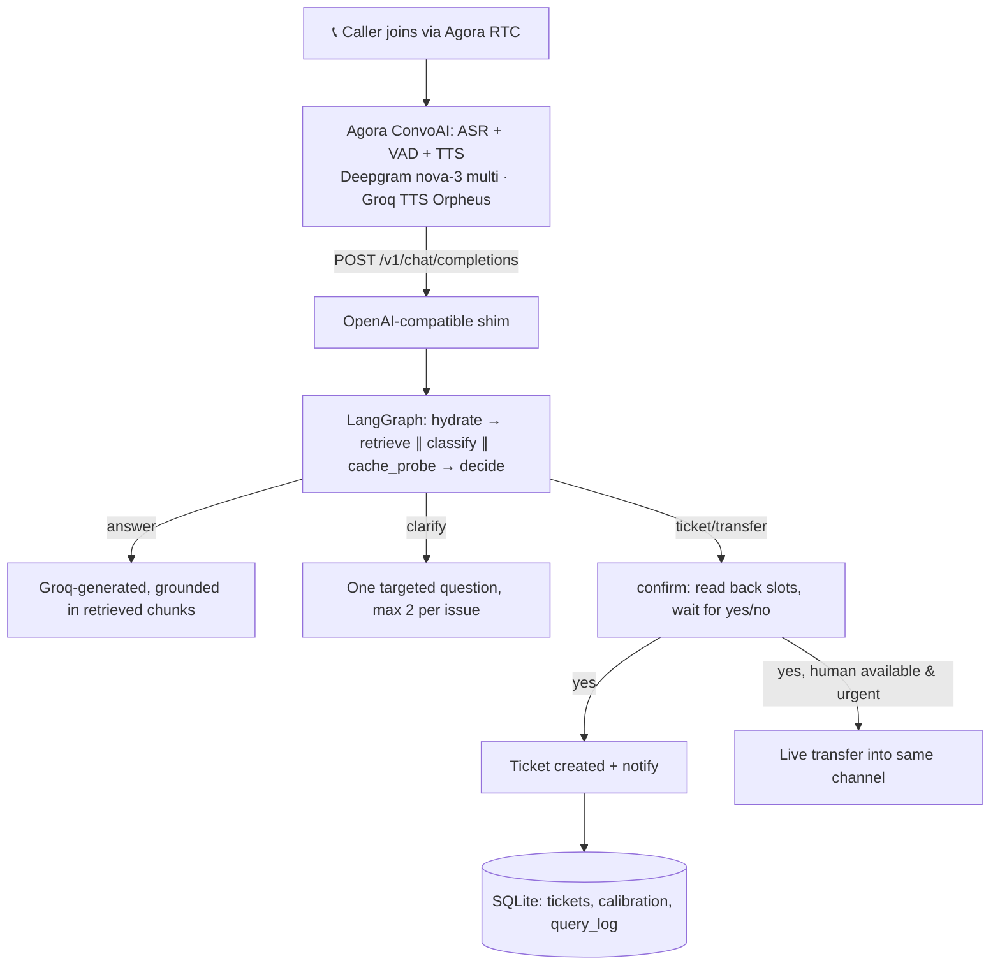

<div align="center">

# 🏙️ Nagar Sahayak

### *A municipal helpline that answers before a human picks up — built on Resolvix.*

**Grounded. Disciplined. Built to refuse when it doesn't know.**

<br/>

[](https://python.org)
[](https://fastapi.tiangolo.com)
[](https://www.agora.io)
[](https://langchain-ai.github.io/langgraph/)
[](https://groq.com)

</div>

---

## The problem

Citizens reporting a pothole, a burst water main, or a blocked drain either
don't know which municipal department to call, or call during hours nobody's
answering. The ones who do get through often repeat the same information
three times to three different people before anything is logged.

**Nagar Sahayak answers the call immediately, in Hindi or English or a mix of
both, asks only what's needed to file a real complaint, reads it back before
submitting, and hands off to a human the moment the situation genuinely
warrants one** — rather than pretending to be a human, or silently dropping a
hazard into the same queue as a routine query.

This is a **domain pack** (`domains/civic_municipal/`) built on **Resolvix**,
a voice-agent core that is intentionally domain-agnostic: the same
orchestration, retrieval, and escalation engine also runs a campus helpdesk
(`domains/campus_akgec/`) with zero changes to the engine itself. Swapping
the entire use case is a new directory of config and content, not new code —
see [Architecture](#architecture) below.

---

## What's demonstrated

- **Full-duplex voice, real barge-in** — interrupt the agent mid-sentence; it
  stops within one turn and starts fresh on what you actually said, not what
  it was about to say.
- **Code-switched, bilingual understanding** — speak Hindi, English, or mix
  both in the same sentence; ASR (Deepgram `nova-3`, `language: multi`)
  handles the switch natively. The agent currently *replies* primarily in
  English — an honest, stated limitation, not a claim of full bilingual
  output (see [Limitations](#known-limitations-honest)).
- **Session memory across turns** — slots filled two turns ago are still
  known when it's time to confirm.
- **Clarification when the request is ambiguous** — at most two targeted
  questions, generated from the actual retrieval ambiguity, never a fixed
  script.
- **Confirmation before any complaint is filed** — the agent reads back what
  it collected and asks a plain yes/no before creating a case.
- **A scored escalation decision, not a keyword table** — urgency is a
  continuous vector (time-criticality, blocking, harm-if-delayed, authority
  required), routed by a policy surface with configurable thresholds per
  domain, not a list of trigger words.
- **Human escalation with a live-availability check** — if a human is
  actually free, the call transfers into the same audio channel; if not, the
  caller is told so out loud and gets a priority ticket instead of a silent
  downgrade.
- **Verified vs. AI-interpreted content, marked and spoken differently** — any
  corpus section not backed by a real source is tagged `provenance:
  synthetic` and the agent audibly hedges those specific claims ("I believe
  X, but let me confirm with the department") rather than stating placeholder
  content as settled fact.

---

## Architecture



Everything above the dashed line inside `core/` is domain-blind — it reads a
`DomainPack` (corpus, prompts, escalation thresholds, queues) at runtime and
never names a domain concept. `importlinter.ini` and
`tests/test_domain_boundary.py` enforce this in CI, not just by convention.

---

## Domain packs

| Pack | What it is |
|---|---|
| `domains/civic_municipal/` | **Nagar Sahayak** — this build. Roads, water, sanitation, electricity, drainage, general. |
| `domains/campus_akgec/` | The original build — a college helpdesk (fees, hostel, exams, admissions, placements). Proves the same engine generalizes. |
| `domains/clinic_demo/` | A minimal third pack proving the boundary holds for a completely different vertical (a clinic line, tighter urgency thresholds). |

Each pack is: `domain.yaml` (identity, greeting, voice, queues), `escalation.yaml`
(thresholds, cost weights), `exemplars.yaml` (classifier rubric anchors),
`prompts/*.md` (system persona, clarify/confirm templates), `corpus/*.md`
(retrieval content, front-matter tagged with `queue` and `provenance`), and
`tools.py` (domain-specific tool calls, currently empty for all three packs —
nothing needed one yet).

---

## Known limitations (honest)

Stating these because a system that claims no weaknesses hasn't been tested.

1. **The civic corpus is currently placeholder content.** Every section in
   `domains/civic_municipal/corpus/*.md` is marked `provenance: synthetic`
   and explicitly flagged `REPLACE WITH REAL MUNICIPAL DATA` — real
   department SLAs and content were being sourced separately at build time.
   The hedging mechanism that handles this honestly is real and tested; the
   content it's hedging is illustrative, not verified municipal data.
2. **TTS output is English-only; ASR input is bilingual.** Groq's available
   Orpheus voice is English-branded with no verified Hindi pronunciation
   quality on this account — an asymmetric design, not a bug, and stated as
   such rather than claimed as full bilingual output.
3. **The Vobiz WhatsApp integration is unverified end-to-end.** The adapter
   (`core/notify/adapters/vobiz.py`) is built against Vobiz's documented API
   and no-ops safely without credentials, but has not been live-tested — it
   needs a real Vobiz account and WhatsApp Business Account this build
   doesn't have access to.
4. **Escalation destinations are placeholders.** `webhook:REPLACE_WITH_REAL_URL`
   and similar markers in `domains/civic_municipal/domain.yaml` need real
   department contacts before this handles a real complaint.
5. **No dashboard authentication.** `web/department.html` is a working
   prototype, not access-controlled.
6. **Single process, single instance.** No horizontal scaling story; fine for
   a demo, not a production claim.
7. **On-submit correction re-collects everything.** If a caller says the
   confirmation readback is wrong, the agent currently re-asks for
   everything rather than just the one incorrect field — a deliberate,
   time-boxed simplification, not the originally-scoped behavior.

---

## Tech stack

| Layer | Choice | Why |
|---|---|---|
| Transport | Agora RTC + Conversational AI Engine | Mandated transport; audio never touches our process in the happy path |
| ASR | Deepgram `nova-3`, `language: multi` | Agora's own managed ASR (`ares`) fails outright on this account (confirmed live); Deepgram's code-switch mode genuinely supports Hindi+English |
| LLM | Groq, `openai/gpt-oss-20b` | Fastest of the models actually available on this account; reasoning hidden via `reasoning_format: hidden` so it doesn't leak into spoken output |
| TTS | Groq, `canopylabs/orpheus-v1-english` via ConvoAI's `generic_http` vendor | English-only on this account; `generic_http` needed an explicit `response_format: wav` and `sample_rate: 24000` to play back correctly — both discovered and fixed live |
| Orchestration | LangGraph | The escalation decision and turn routing are a real compiled graph, not a prompt loop |
| Retrieval | BM25 + dense (fastembed `bge-small-en-v1.5`), RRF fusion | Hybrid beats either alone on short spoken queries |
| Tickets | SQLite | Zero external dependency; idempotent creation survives a barge-in-cancelled retry |
| Escalation notify | `console:` / `webhook:` / `vobiz:` / `whatsapp:` / `email:` adapters | Same `Destination` protocol regardless of vendor; missing credentials degrade to a log line, never a crash |

Every service used sits on a free tier. Total infrastructure cost: **$0.**

---

## Quick start

```bash
git clone <this-repo>
cd Resolvix

pip install -r requirements.txt
cp .env.example .env    # fill in AGORA_*, GROQ_*, DEEPGRAM_*, and (optional) VOBIZ_*

uvicorn resolvix.app:app --reload --port 8000
ngrok http 8000          # Agora ConvoAI needs a public HTTPS URL for the LLM shim
```

Set `PUBLIC_BASE_URL` in `.env` to the ngrok URL, restart, then open
`http://localhost:8000/?appId=<your Agora App ID>&domain=civic_municipal` for
the caller page, or `/department` for the staff console.

Run the domain-boundary test suite any time you touch anything:

```bash
python -m pytest tests/test_domain_boundary.py -v
lint-imports --config importlinter.ini
```

---

## Repository layout

```
resolvix/                    the engine — domain-blind, enforced by CI
├── app.py                   composition root
├── core/
│   ├── transport/           Agora token server, ConvoAI client, admission queue
│   ├── openai_shim/         POST /v1/chat/completions, SSE framing, cancellation
│   ├── graph/               LangGraph nodes: hydrate/retrieve/classify/decide/
│   │                        confirm/answer/clarify/ticket/transfer/finalize
│   ├── routing/             urgency classifier, policy surface, calibration
│   ├── retrieval/           hybrid BM25+dense index, chunking, semantic cache
│   ├── tickets/             SQLite store + API
│   ├── notify/adapters/     console, webhook, whatsapp, email, vobiz
│   └── domain/              the DomainPack contract + loader
domains/
├── civic_municipal/         Nagar Sahayak — this build
├── campus_akgec/            the original build
└── clinic_demo/             proves the boundary generalizes further
web/                         caller.html, department.html
tests/test_domain_boundary.py
importlinter.ini             CI-enforced layer contract: core/ never imports domains/
```

---

## Adapting to another domain

Copy `domains/civic_municipal/` (or any pack), replace `domain.yaml`,
`escalation.yaml`, `corpus/*.md`, and `prompts/*.md`. Nothing under `core/`
needs to change — that boundary is what let this exact rebuild happen inside
a five-hour pivot from a completely different use case (a college helpdesk),
and it's checked by `tests/test_domain_boundary.py` and `importlinter.ini`,
not just asserted in this README.

---

## License

MIT — see [`LICENSE`](./LICENSE).
