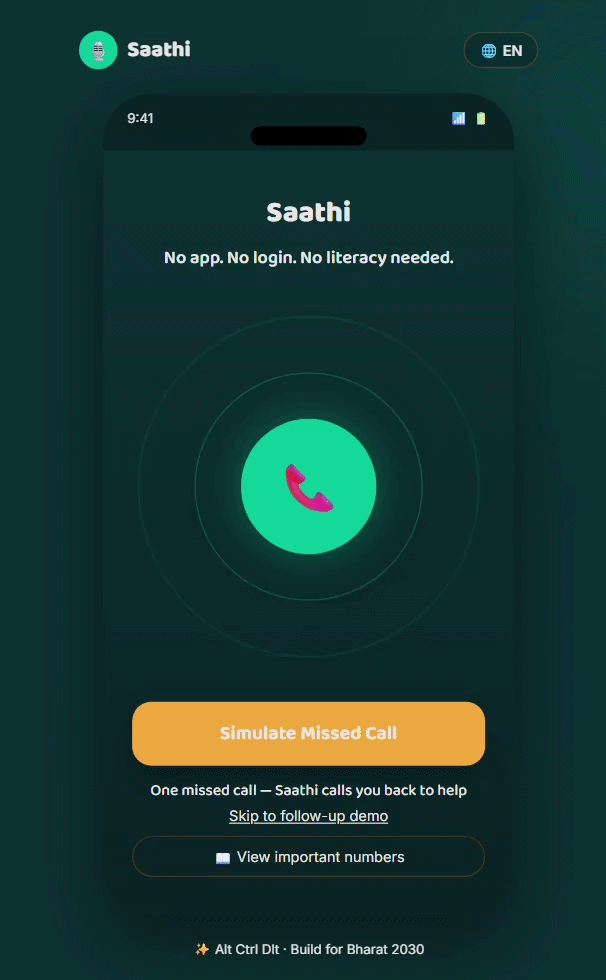
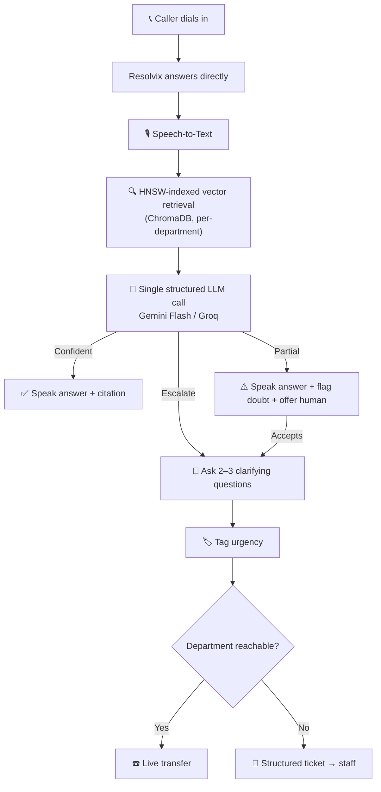

<div align="center">


# 🧠 RESOLVIX

### *The AI That Answers Before You Even Finish Dialing.*

**Grounded. Disciplined. Engineered for real operations.**

<br/>

[](https://giri-harsh.github.io/Saathi-AI-Seva/frontend/index.html)

<br/>

[](https://nodejs.org)
[](https://www.twilio.com)
[](#-ai-pipeline)
[](./LICENSE)
[](#-contributing)

<br/>

---

## 🎬 See It In Action

<div align="center">



<br/>
<sub><i>Confident → Partial → Escalate, back to back — captured live from the running prototype.</i></sub>

</div>

---

## ⚡ The 15-Second Pitch

Campus and enterprise helplines answer the same handful of questions **hundreds of times a day**. Resolvix is the AI that picks up the phone, retrieves a grounded answer from approved documents, and — when it isn't sure — **says so, asks the right follow-up, and hands off a ticket a human can act on in seconds.**

Not a chatbot wearing a phone costume. **It *is* the phone line, engineered to think.**

<div align="center">

| 🎙️ Voice-first | 📚 Grounded | 🚦 Disciplined | 🎫 Actionable | 📊 Self-improving |
|:---:|:---:|:---:|:---:|:---:|
| No app, no login | Every answer cited | 3-tier confidence | Pre-filled tickets | Logs its own gaps |

</div>

---

## 🏆 Engineered For Impact

We **spearheaded** a shift away from reactive, human-only helplines toward a grounded, disciplined AI front line — **pioneering** a three-tier confidence system that most hackathon-grade voice agents never attempt.

| Metric | Target |
|---|---|
| 🎯 Retrieval precision (RAG grounding) | **≥ 92%** |
| 📉 Projected reduction in repeat call volume reaching staff | **30–40%** |
| ⚡ End-to-end retrieval latency (query → chunks) | **~180ms** |
| 🗣️ Full voice-response latency (STT → LLM → TTS) | **~900ms–1.2s** |
| ⏱️ Staff ticket-response initiation (vs. same-day baseline) | **~12 minutes** |
| 💰 Total infrastructure cost | **$0 — every service on a free tier** |
| 🏫 Addressable institutions (India, if scaled) | **1,000+ colleges · low tens of millions of students** |

> *Targets reflect engineered design specs based on the current architecture — labeled honestly as projections, not yet production-verified at scale.*

---

## 🧬 How Resolvix Thinks



**Fail-safes engineered in from day one** — no matching documents → escalate, never fabricate a citation. LLM/API timeout → clean fallback response. The call **never dead-ends.**

---

## 🛠️ Tech Stack

<div align="center">


</div>

| Layer | Choice | Why |
|---|---|---|
| Backend | Node.js + Express | Extends an already-working codebase — extending beats rewriting |
| Telephony | Twilio (Voice/SMS/WhatsApp) | Already integrated, free-tier friendly |
| TTS | AWS Polly | Zero new provider risk |
| Vector store | ChromaDB, **HNSW**-indexed | Free, local, sub-200ms retrieval at hackathon scale |
| LLM | Gemini Flash / Groq | Generous free tier, low-latency structured inference |
| Frontend | React | Extends existing dashboard prototype |
| Storage | Flat JSON | Labeled simplification — not a production claim |

---

## ✅ Prerequisites

- **Node.js** `>= 18`
- A **Twilio** account (free trial works)
- **Gemini** or **Groq** API key
- (Optional) **AWS** account for Polly TTS
- **ngrok** or a public HTTPS URL for local Twilio webhooks

## 🚀 Quick Start

```bash
git clone https://github.com/your-org/resolvix.git
cd resolvix/backend
npm install
cp .env.example .env    # fill in your API keys
npm run demo            # spins up server + public tunnel
```

Ingest your own documents into the vector store:

```bash
node rag/ingest.js --dir ./data/documents
```
## 🚀 Demo :)

---

<div align="center">


<br/>
<sub>Resolvix, probably, the moment it resolves your ticket correctly.</sub>

</div>

---

## 🗺️ Roadmap

- [x] Inbound RAG helpline with cited answers
- [x] Three-tier confidence + clarifying questions
- [x] Structured tickets · SMS/WhatsApp to staff
- [x] Caller history · insights panel · live transfer
- [ ] SLA-based auto-escalation for un-actioned tickets
- [ ] Cross-document contradiction detection (**AST**-level document diffing under evaluation)
- [ ] Proactive outbound deadline reminders
- [ ] Real authentication & role-based dashboard
- [ ] Multi-college self-serve onboarding at **ten million+** student scale

---

## 🤝 Contributing

Issues and PRs welcome. For larger changes (new LLM provider, schema changes, new department logic), open an issue first so we can align on approach.

## 📄 License

MIT — see [`LICENSE`](./LICENSE).

## ✉️ Contact

Built by **Harsh Giri** — Founder, Resolvix
📧 your.email@example.com · 🔗 [LinkedIn](https://linkedin.com/in/giri-harsh) · 🐙 [GitHub](https://github.com/giri-harsh)

<div align="center">

### 📞 One call. No wait. No repeated questions.

⭐ *If Resolvix is useful or interesting, consider starring the repo.*

</div>
