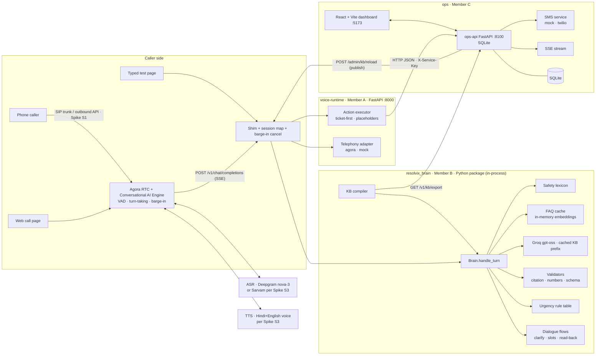

# Resolvix: Final Unified PRD and Team Build Plan

**Version:** 1.0 (merged). It supersedes all three source PRDs.
**Sources merged:**
- **[H]** Harsh's PRD (`PRD_Resolvix.md`: Agora, CAG, Groq). This is the primary foundation.
- **[F1]** Friend PRD 1 (`RESOLVIX_PRD.pdf`, v1.0 MVP).
- **[F2]** Friend PRD 2 (`Resolvix_PRD_Feature_List_and_Build_Plan.pdf`).

**Companion files in this package:**
- `contracts/`: frozen shared contracts, made of Pydantic models, JSON Schemas, OpenAPI specs, fixtures, config and a sample KB.
- `prompts/`: three copy-ready coding-agent prompts.

Tags used in this document:
- **[KEEP]** retained from [H]
- **[MERGE]** combined or improved using a friend PRD
- **[NEW]** a decision made during the merge
- **[ASSUMPTION]** a gap filled with a reasoned default

---

## 1. Executive summary

**Resolvix** is a real-time, multilingual AI voice agent that answers a college helpline. Parents, students and the public call the number and speak in Hindi, English or Hinglish. Resolvix answers **only from approved college knowledge** and says the source. It **never invents** fees, dates or rules.

It **escalates** in two cases:
1. **Unknown:** the answer is not in the approved knowledge.
2. **Urgent, or the caller needs a person or department.**

Escalation always creates a **ticket first**. After that it may transfer the call, alert staff by SMS or schedule a callback. Staff work the tickets on a live dashboard. Every unanswered question lands in a **knowledge-gap view**, so the documents improve week by week.

**Key decisions in the merge:**

| Topic | Decision | Why |
|---|---|---|
| Voice stack | **Agora Conversational AI Engine** (streaming, barge-in) [KEEP] instead of Twilio `<Gather>` turn-based [F1/F2] | The team knows Agora, and it gives real-time conversation. Twilio is still used for the SIP trunk and SMS. |
| Knowledge | **CAG:** the whole approved KB sits in a cached LLM prompt prefix, plus an in-memory FAQ semantic cache [KEEP]. **No ChromaDB RAG** [F1/F2 excluded]. | Less retrieval latency and no missed-chunk failures on a small curated KB. Groq's automatic prompt caching makes a large static prefix cheap. |
| Grounding | Code decides the final tier [MERGE F1 FR-1.7]. Every cited KB id must exist, and every number or date spoken must appear in the cited entries. **Validate before speaking.** | Turns "zero fabricated figures" into a code guarantee instead of a prompt hope. |
| Urgency | The LLM only **extracts facts**. A deterministic **rule table** assigns P1–P4 and stores the reason [MERGE F1 §7]. A safety lexicon runs before the LLM [KEEP]. | Explainable, testable and auditable priorities. |
| Escalation | **Ticket-first** before any transfer [MERGE F1 FR-3.5]. An unanswered transfer leaves the ticket open. A spoken fallback ladder covers failures [F1/F2]. | A call never dead-ends. |
| Complaints | Slot filling, then read-back, then explicit "yes", then ticket, then the ID spoken digit by digit, then SMS [MERGE F1 F4]. | Prevents wrong or duplicate tickets. |
| SMS | Policy-gated, template-only, idempotent, DLT-aware; mock or test sender until approved [MERGE F1 §8]. | Indian regulation (DLT) plus duplicate prevention. |
| MVP departments | Exam Cell, Accounts/Fees, Hostel (+ General Helpdesk + Emergency) [MERGE F1 §4]. Transport and Admissions are data-only. | Keeps the demo focused; the code path is identical for every department. |
| Storage | **SQLite via SQLAlchemy** for the hackathon (switchable to Postgres), in-memory sessions; **no Redis in the MVP** [NEW] | Fewer moving parts for a 3-person, 24–48 h build. |
| Team split | **A** voice runtime and integration · **B** brain (knowledge + decisions) · **C** ops API and dashboard | Each package runs alone against fixtures. Contracts are frozen up front. |

**Suggested owners** (taken from both friend PRDs and the stack familiarity in [H]):
- **A:** Harsh (Agora, integration lead)
- **B:** Kamal (knowledge, LLM, eval)
- **C:** Dishant (dashboard, tickets, SMS)

Swap freely; the packages don't depend on who takes them.

---

## 2. Analysis of the three PRDs

### 2.1 Side-by-side comparison

| Dimension | [H] Harsh | [F1] Friend 1 | [F2] Friend 2 | Merge decision |
|---|---|---|---|---|
| Core vision | AI answers the helpline, KB-only, 2 escalation triggers, USPs | Same, plus "authorised actions", measurable value, strong governance | Same, simpler prototype | Same vision in all three; [H] wording kept |
| Voice | Agora streaming, barge-in, Hinglish | Twilio turn-based; barge-in deferred to Phase 2; p95 ≤ 4 s | Twilio Gather + Polly; ≤ 6 s | **Agora** (better UX, team skill). Friends' turn-based design kept as the **typed/web fallback**, not the primary path. |
| Knowledge | CAG + FAQ cache, no RAG | ChromaDB RAG with metadata filters, doc lifecycle, injection scan | ChromaDB RAG | **CAG** kept. From F1 we add the **document lifecycle** (draft → approved → archived), **validity filters**, the **injection scan**, and **quoted-data prompting**. |
| Confidence | META header from the LLM + citation validator | **Code-computed tier**, number/date grounding check, LLM self-rating is only an input | Similarity threshold + citation check | **Merged:** META + code-decided tier + numeric grounding |
| Urgency | Lexicon + LLM urgency field + decision table | **LLM extracts facts → rule table → P1–P4 + reason**; tone never changes priority | Keywords + LLM flag | **F1 model adopted**, plus the [H] safety lexicon |
| Escalation | Tickets, transfer, warm brief, callback, whisper | **Ticket-first**, sequential dialing, brief before pickup, unanswered transfer keeps the ticket | Ticket + SMS + optional Dial | **Ticket-first + brief** (F1) inside the [H] escalation engine; whisper deferred |
| Complaint | Part of escalation | Full slot → read-back → confirm → SMS flow | Clarifying questions (P1) | **F1 flow adopted (P0)** |
| SMS | Receipt (P1) | Detailed policy, DLT, dedupe, delivery tracking | Staff SMS (P0) | **F1 policy adopted**, scaled down: templates, consent, dedupe, mock/test sender |
| Dashboard | Live, tickets, gap radar, KB, analytics, try-it | Live board, ticket detail, doc manager, gaps, rules view, roles, audit | Ticket list, call log, gaps | Union, cut to the P0 set (§4) |
| Safety | Lexicon → script → transfer → P1 | Emergency pre-check before retrieval | Keywords | Same idea in all three; [H] implementation |
| Silence/re-prompt | Filler line | **Silence prompts at 5 s and 10–12 s**, one re-prompt for unclear speech | One re-prompt | Adopted where the Agora engine allows it (Spike S4) |
| Data store | Postgres + Redis | Postgres + job queue | SQLite/JSON | **SQLite (SQLAlchemy)**; Postgres-ready |
| Stack language | Python/FastAPI, Next.js | Node/Express, React | Node/Express, React+Vite | **Python** for all backends (matches Agora/LangGraph experience and the in-process brain); **React+Vite** dashboard (F2: faster than Next.js) |
| Eval | 150+ golden set etc. | 60 questions (15 must-abstain, 10 urgency); offline eval **before** voice wiring | 30 per language | **F1 sizes**, plus a safety set; offline-first rule adopted |
| Honesty on claims | Targets marked | 30–40 % is a hypothesis; cost not "zero" | Same | Adopted: no unverified claims anywhere |
| Ops readiness | Spikes S1–S5 | Long-lead tasks (DLT, numbers, docs) on day one | Backup recording, typed test page | All adopted |

### 2.2 Overlaps, conflicts and how they were resolved

- **RAG vs CAG** (conflict). [H] is primary and the KB is small and curated, so we keep CAG. F1's governance (lifecycle, validity, injection scan) is moved into the KB pipeline. If Spike S2 shows prompt caching doesn't hold, the fallback is to shrink the KB prefix and lean on the FAQ cache. It is **not** a switch to RAG mid-hackathon.
- **Twilio vs Agora** (conflict). Agora for voice. Twilio stays for the SIP trunk (Agora's documented inbound path) and SMS.
- **Streaming vs validation** (tension). Validation needs the full answer text. Spoken answers are 2 sentences (~40–80 tokens), so we **buffer the full LLM answer, validate it, then stream it to TTS sentence by sentence**. The extra cost is roughly 100–200 ms at Groq speeds, which we accept for the zero-fabrication guarantee. The FAQ and safety paths stream immediately.
- **Priority scales** (conflict: [H] P0–P3 vs [F1] P1–P4). We adopt **P1–P4** from F1, with P1 covering emergency and imminent exams.
- **Language selection** (conflict: [F2] asks the caller to pick vs [H] auto-detect). We use auto-detect with a bilingual greeting, because a menu re-creates the IVR problem.

### 2.3 Unrealistic for a 24–48 h window (moved out of the MVP)

- Spoken "whisper" to staff before connect, auto outbound callbacks, ERP lookups, OTP verification, WhatsApp channel, contradiction detection, multi-college SaaS, SLA auto-escalation, retention jobs, a full RBAC matrix, and load testing at peak.

### 2.4 Most compelling problem and workflow

- **Problem:** routine questions clog the only helpline, and urgent callers wait behind them.
- **Workflow to demo:**
  1. A Hindi fee question is answered in seconds with its source.
  2. An urgent "exam in 15 minutes" call creates a P1 ticket with a stored reason and a staff brief, then a transfer.
  3. An unknown question becomes a ticket plus a knowledge gap.
  4. Staff see it all live on the dashboard. A staff answer is added to the KB, and the same question is answered on the next call.

---

## 3. Final unified PRD

### 3.1 Product overview

- **Name:** Resolvix
- **One-line pitch:** The AI that picks up your college helpline: verified answers, honest escalation, in the caller's language.
- **Vision:** a reliable, multilingual, voice-first college agent that answers only from verified knowledge, escalates intelligently and gives staff only the calls that need a human.
- **Problem:** the same fee, exam, hostel and admission questions arrive daily by phone, often from parents who won't use an app. Urgent calls queue behind routine ones. The line closes after office hours. Answers vary by staff member. Nobody records which questions the documents fail to answer.
- **Target customers:** colleges and universities that run a phone helpline (MVP: one college, three departments).
- **Users:** callers (parents, students, applicants), department staff, the helpdesk/department admin, and college administration.
- **Value proposition:**
  - Callers get instant, consistent, sourced answers at any hour.
  - Staff receive only real cases, with context and an explicit priority.
  - Administration sees what is being asked and what is missing.
- **Why it matters:** the phone is the channel parents actually use, and no existing low-cost tool answers it intelligently.

### 3.2 Problem analysis

- **Existing workflow:** caller dials → busy line, hold, or an IVR menu → a staff member answers from memory or a notice → transfers repeat the context → no record is kept.
- **Pain points:**
  - repetitive load
  - no after-hours coverage
  - language mismatch
  - urgent calls queued with routine ones
  - inconsistent answers
  - lost context on transfer
  - no visibility of gaps
- **Limits of existing approaches:**
  - FAQ pages and web chatbots don't touch the phone.
  - WhatsApp groups are unofficial and unrecorded.
  - IVR trees can't understand natural speech.
  - Enterprise contact-centre AI is sized and priced for large call centres.
- **Improvement we aim to measure (not claim):**
  - containment rate (calls resolved without staff)
  - grounded-answer rate
  - zero fabricated figures
  - P1 recall
  - time-to-first-audio

  The "30–40 % fewer calls reaching staff" from the deck is a **hypothesis to test**, not a result.

### 3.3 Personas and use cases

| Persona | Goal | Primary journey |
|---|---|---|
| Parent (Hindi-first) | Fees, admissions, hostel info | J1 answered call |
| Student | Exam logistics; urgent help | J1, J3 urgent |
| Applicant / public | Process, documents, timings | J1, J2 unknown |
| Department staff | Work only real cases, fast | J5 dashboard |
| Department admin | Keep the KB correct; close gaps | J6 KB publish |

**End-to-end journeys:**

- **J1 · Answered:**
  1. Greeting and consent line.
  2. The caller asks.
  3. Safety check, then FAQ or LLM answer.
  4. Validation.
  5. The answer is spoken with its source.
  6. "Anything else?"
  7. Optional SMS copy, only if the caller asks.
- **J2 · Unknown → ticket + gap:**
  1. The answer is not grounded.
  2. "I don't have verified information."
  3. The agent offers a ticket and confirms the callback number (defaults to the caller ID).
  4. Ticket (P3, KNOWLEDGE_GAP).
  5. The ID is spoken.
  6. SMS with the ID.
  7. The gap is logged.
- **J3 · Urgent → ticket-first → transfer:**
  1. The LLM extracts facts.
  2. Rule R-EXAM-60 fires: P1.
  3. At most 2 targeted questions (roll number, paper).
  4. Ticket with brief.
  5. "Connecting you."
  6. Transfer, dialing the department numbers in order.
  7. If nobody answers, the ticket stays open and the caller is told it will be followed up.
- **J4 · Complaint:**
  1. Category, details, location, callback number (at most 2 follow-ups).
  2. Read-back.
  3. Explicit yes.
  4. Ticket.
  5. ID spoken.
  6. SMS.
- **J5 · Staff:** the dashboard live board shows the new P1 with its brief and priority reason → open the ticket → transcript → set status or note → status SMS to the caller (consented).
- **J6 · Self-healing KB:**
  1. The gap cluster shows "Bus routes ×7".
  2. The admin adds or approves an entry.
  3. Publish.
  4. The runtime reloads the KB.
  5. The next caller gets the answer.
- **J7 · Emergency:**
  1. Lexicon hit.
  2. Fixed script (with official emergency numbers), not interruptible.
  3. P1 EMERGENCY ticket.
  4. Staff SMS alert.
  5. Transfer to the on-call number.

### 3.4 Unified feature set

#### P0: essential MVP

| ID | Feature | Owner | Origin |
|---|---|---|---|
| P0-01 | Real-time voice loop on Agora (web call widget guaranteed; PSTN inbound or outbound per Spike S1); barge-in | A | [KEEP] |
| P0-02 | OpenAI-compatible streaming shim that Agora calls; runs the brain in-process | A | [KEEP] |
| P0-03 | Action executor: ticket-first, transfer with fallback, SMS, gap, end call; ticket-ID placeholder substitution | A | [MERGE] |
| P0-04 | Typed-input test page (same pipeline, no audio) as the demo backup | A | [MERGE F2] |
| P0-05 | KB compiler: approved and valid entries only, deterministic prefix, token budget, version hash, hot reload | B | [MERGE] |
| P0-06 | FAQ semantic cache (in-memory, multilingual embeddings) | B | [KEEP] |
| P0-07 | CAG answer via Groq with META header; validate-then-speak; code-decided tier; numeric grounding | B | [MERGE F1] |
| P0-08 | Safety lexicon pre-check and emergency script | B | [KEEP] |
| P0-09 | Urgency fact extraction + rule table → P1–P4 + reason | B | [MERGE F1] |
| P0-10 | Dialogue manager: clarify (≤ 2), slot filling, read-back + confirm, human request, unclear-speech re-prompt, fallback ladder | B | [MERGE F1] |
| P0-11 | Bilingual (hi/en/Hinglish) replies, spoken-text normalisation (dates, amounts, IDs) | B | [KEEP + F1] |
| P0-12 | Offline eval harness (60 + 20 + 10 sets) that passes before voice wiring | B | [MERGE F1] |
| P0-13 | Ops API: calls, turns, tickets (idempotent), ticket events, gaps, KB entries/import/export/publish, departments, rules view, SSE | C | [MERGE] |
| P0-14 | SMS service with policy (templates, consent, dedupe, URL whitelist), mock/test-sender modes | C | [MERGE F1] |
| P0-15 | Dashboard: login, live board (P1 alert), ticket detail (brief, reason, transcript, status, notes), calls, gap view, KB manager (import, approve, publish), rules view | C | [MERGE] |
| P0-16 | Audit log (ticket changes, KB publish, transcript views) | C | [F1] |

#### P1: high-value enhancements (only once P0 is stable)

| ID | Feature | Owner |
|---|---|---|
| P1-01 | Repeat-caller memory (open tickets for the caller ID passed into CallContext) | A + B |
| P1-02 | Silence handling (prompt at ~5 s, then again at ~10–12 s, then offer SMS/callback and close) if the engine exposes idle events | A |
| P1-03 | SMS answer copy on request (whitelisted official URL) | B (action) + C |
| P1-04 | Gap clustering by embedding similarity (P0 is keyword/department grouping) | C |
| P1-05 | Analytics panel: calls per hour, containment, escalation reasons, language mix, latency by path | C |
| P1-06 | Hot notices (time-boxed announcements in the prefix) | B + C |
| P1-07 | Department-scoped staff views (role filter) | C |
| P1-08 | Staff "Add answer to KB" from a ticket, creating a draft entry | C |
| P1-09 | Callback scheduling action (record + dashboard queue; outbound dialing is P2) | B + C |

#### P2: future scope

Whisper handoff, automatic outbound callbacks via the Agora outbound API, WhatsApp, OTP and ERP lookups, SLA auto-escalation, contradiction detection between documents, more Indian languages, multi-college packs, retention jobs, Postgres + Redis + horizontal scaling, load testing.

### 3.5 Functional requirements (P0)

Each requirement lists its purpose, trigger, inputs, processing, outputs, integrations, failure behaviour and acceptance criteria.

---

#### FR-A1 Voice session and shim (P0-01, P0-02)

- **Purpose:** connect callers to the brain in real time.
- **Trigger:** web call start (`POST /api/sessions/web`), an outbound test call, or an inbound SIP call (Spike S1). After that, every Agora LLM request.
- **Inputs:** Agora chat request (`fixtures/agora/chat_request.json`) with `call_id` in the query string, or the fallback system message `RESOLVIX_CALL_ID=<id>`.
- **Processing:**
  1. Authenticate the bearer token.
  2. Resolve `call_id`. If it is new, call `ops POST /v1/calls`, then `brain.start_call()`. The greeting is configured as the agent's greeting message at start.
  3. Take the last `user` message as `user_text` and build a `TurnRequest`.
  4. Iterate `brain.handle_turn()`.
  5. The `MetaEvent` becomes the first SSE chunk `chat.completion.custom_metadata {interruptable}`.
  6. `SpeechEvent`s become `chat.completion.chunk` deltas.
  7. `ActionEvent`s go to the executor (FR-A2).
  8. `DoneEvent` → `POST /v1/calls/{id}/turns` (fire-and-forget with retry).
  9. Finish chunk, then `data: [DONE]`.
- **Barge-in:** a new request for the same `call_id` while a stream is active cancels the previous `handle_turn` iterator (task registry keyed by `call_id`).
- **Outputs:** an SSE stream exactly like `fixtures/agora/expected_sse_for_04.txt`.
- **Integrations:** Agora REST (start/stop agent, tokens), ops-api, brain.
- **Failure:**
  - Brain exception: stream the runtime fallback line and create a SYSTEM_FAILURE ticket.
  - ops-api down: queue the writes in memory and retry every 5 s, but never block speech.
  - `stream=false`: return 400.
- **Acceptance:**
  - Web call, two-way audio.
  - Barge-in stops agent speech, and the new answer follows.
  - Per-turn `latency_ms` is logged.
  - The SSE output matches the fixture format.

#### FR-A2 Action executor (P0-03)

- **Purpose:** carry out brain decisions safely and in order.
- **Trigger:** an `ActionEvent`.
- **Processing:**
  - **Blocking actions** finish before the next event is processed.
  - **`create_ticket`:**
    1. `POST /v1/tickets` with retry ×2 and a 2 s timeout.
    2. Store `ticket_id` for the turn.
    3. Replace `{{ticket_id}}` in later speech and SMS vars with `speak_ticket_id(id, lang)` for speech and the raw id for SMS.
    4. If C is unreachable: generate a local `TMP-xxxx`, queue the create for retry, and still speak "your request is registered" without an ID.
  - **`transfer`:**
    1. Check that a ticket exists for the turn (ticket-first).
    2. `POST /v1/tickets/{id}/events transfer_attempted`.
    3. Attempt `TelephonyAdapter.transfer(to_number)`.
    4. On failure or no answer: `transfer_failed` event; speak `runtime_lines.transfer_failed` ("Staff abhi uplabdh nahi hain. Aapka request {id} khula hai, aapko jaldi contact kiya jayega."). The ticket stays open.
    5. Web or test channel: simulate, emit the event, and speak `transfer_simulated` in test mode only.
  - **`send_sms`:** `POST /v1/notifications/sms` (non-blocking).
  - **`log_gap`:** `POST /v1/gaps` (non-blocking).
  - **`end_call`:** stop the agent after the current speech.
  - **`schedule_callback`:** P1; post as a ticket event.
- **Acceptance:**
  - All 9 brain-stream fixtures replay through the executor with a mock ops-api and produce the expected calls in order.
  - A transfer is never attempted before a ticket exists.
  - The duplicate-request replay test creates one ticket (idempotency key).

#### FR-A3 Typed test page (P0-04)

- `GET /test` serves a static page. It posts `POST /api/test/turn` and shows the events, the spoken text and the actions.
- Same brain and executor; channel=`test`.
- **Acceptance:** all demo scenarios run without audio.

---

#### FR-B1 KB compiler (P0-05)

- **Trigger:** `reload_kb(KBSource)` at startup (from file) and on publish (from URL).
- **Inputs:** `KBExport` JSON or a `kb.jsonl` of `KBEntry`.
- **Processing:**
  1. Schema-validate.
  2. Keep `status=approved` and valid today (`valid_from ≤ today ≤ valid_until`).
  3. Injection scan: entries containing instruction-like text ("ignore previous", "system prompt", "you are now") are excluded and listed in warnings.
  4. Dedupe question variants.
  5. Sort by (department, id).
  6. Render the prefix with the persona, rules, output protocol, KB entries as **quoted data** in fenced blocks, and the department directory.
  7. Token count against `KB_TOKEN_BUDGET` (default 90k; fail with a report if exceeded, never truncate).
  8. Build the FAQ index (`is_faq` entries and all their question variants).
  9. `kb_version` = sha256(prefix)[:12].
  10. Atomically swap the active version, then send one warm-up LLM call.
- **Outputs:** `KBVersionInfo`.
- **Failure:** a validation or budget failure keeps the previous version active and returns the problems list. The runtime maps it to 422.
- **Acceptance:**
  - The same input gives the same `kb_version`.
  - Expired, draft or flagged entries never appear.
  - Reload during a call doesn't change that call's pinned version.

#### FR-B2 Turn pipeline (P0-06 to P0-11)

The order is fixed. Each step either returns a terminal plan or passes on.

0. **Session:** load the brain session (pinned `kb_version`, language, slots, pending flow, unknown-streak, unclear-streak).
1. **Safety lexicon** (< 5 ms, normalised text, romanised + Devanagari). It **always runs first, even inside a pending flow**. On a hit, path=`safety`, run the emergency plan (§3.6).
2. **Pending flow:** if a clarify, slot or confirm flow is open, handle the reply (slot extraction by regex, plus the LLM in JSON mode for free text). A read-back expects yes or no; on "no", ask what to correct (once), then escalate.
3. **Human request** (lexicon, `dtmf=="0"`, or LLM intent): R-HUMAN plan.
4. **Unclear input:** empty or very short (< 2 words) with no FAQ hit → one re-prompt ("Maaf kijiye, phir se boliye?"). The second time, offer a human or a ticket.
5. **FAQ cache:** embed with `multilingual-e5-small`; cosine KNN over FAQ variants.
   - `sim ≥ 0.90` → answer from the entry (`answer_hi` or `answer_en` by language), path=`faq`, tier=`confident`.
   - `0.80–0.90` → pass the top-3 ids as hints to the LLM.
6. **LLM (CAG):** messages = cached static prefix + dynamic system block (date and time, office-hours status, caller language, FAQ hints, open tickets) + the last 8 turns.
   - Model `openai/gpt-oss-120b` with `reasoning_effort=low`; `max_tokens` 300; 3 s time-to-first-token timeout; one retry on `gpt-oss-20b`.
   - Output = `<meta>{json}</meta>` + spoken text. The META schema: `tier`, `kb_ids`, `lang`, `intent`, `urgency_facts`, `needs`.
   - **Buffer the full response**, then validate.
7. **Validation** (code decides):
   - **a.** META parses against the schema. On failure: one retry if the elapsed time is under 1.5 s, else fallback.
   - **b.** `tier∈{confident,partial}` requires non-empty `kb_ids` that all exist in the pinned version. Otherwise downgrade to `escalate` (flag `citation_invalid`).
   - **c.** Numeric grounding: every number, date, amount or time in the spoken text (normalising digits, Hindi number words and month names) must appear in the cited entries' answers. Otherwise flag `number_not_in_source` and downgrade (`confident` → `partial` if at least one fact is grounded, else `escalate`).
   - **d.** Spoken text ≤ 2 sentences (trim extras) and no markdown or URLs.
8. **Urgency rules:** the `urgency_facts` (plus intent and tier) go through the rule table (`config/urgency_rules.yaml`, first match wins) to give priority, type, department and action, plus `rule_id` and `priority_reason`.
9. **Plan:**
   - P4 with tier `confident`/`partial` → speak.
   - `clarify` → ask the single most useful question (counts toward the ≤ 2 clarify limit).
   - Escalate or P1–P3 → escalation plan (§3.6).
10. **Emit events:** `MetaEvent` → `SpeechEvent`s (sentence-split) and `ActionEvent`s in plan order → `DoneEvent(TurnSummary)`.

**Spoken normalisation:**
- Dates as "30 November"; amounts as "95 hazaar rupaye" or "95 thousand rupees".
- Phone numbers read in groups; ticket IDs via the `{{ticket_id}}` placeholder.
- Times as "raat 10 baje" / "10 pm".

**Failure:** any exception yields the fixed fallback (fixture `08_llm_failure_fallback`). `handle_turn` never raises.

**Acceptance:** see §3.12 targets. All 9 fixture scenarios are reproducible from text input.

---

#### FR-C1 Ops API (P0-13)

Implements `contracts/openapi/ops-api.yaml` exactly.

- SQLite file DB via SQLAlchemy 2. Alembic is optional; `create_all` is fine for the hackathon.
- Ticket ID = department `ticket_prefix` + a global sequence starting at 1001 (`EX-1042`).
- Idempotency:
  - `POST /v1/tickets` keyed on `idempotency_key` (unique index).
  - Turns keyed on (`call_id`, `turn_index`).
  - SMS keyed on `idempotency_key`.
- SSE `/v1/stream` broadcasts `call.started`, `call.turn`, `call.ended`, `ticket.created`, `ticket.updated`, `alert.p1` and `gap.created`.
- Auth: an `X-Service-Key` header for A, and a session cookie for the dashboard. Users come from a seed file: an admin plus one staff user per MVP department.
- **Acceptance:**
  - A contract test hits every endpoint with the fixtures.
  - A duplicate create returns the same ticket.
  - A P1 creation emits `alert.p1` within 1 s.

#### FR-C2 SMS service (P0-14)

- Policy checks, in order:
  1. template exists
  2. consent value allowed for the template
  3. no duplicate key
  4. vars contain no roll number together with a name, no marks, no dues
  5. URLs whitelisted
  6. the number is E.164.
- A failed check gives `status=suppressed` with a reason.
- Modes:
  - `NOTIFY_MODE=mock` (default): store it and show it on the dashboard as "SMS (mock)".
  - `NOTIFY_MODE=twilio`: Twilio Messaging API to verified or test numbers; delivery status via callback if reachable, else polling; one retry.
- **Indian SMS requires DLT-registered sender and templates.** Until then, use a clearly labelled test sender or mock mode. This is never presented as production-ready.
- Ticket status change by staff → one `status_change` SMS (deduped by `ticket_id:status`).
- **Acceptance:** the retry test sends no duplicates, and suppressed messages show their reason.

#### FR-C3 Dashboard (P0-15)

Pages:
- **Login**
- **Live board:** active calls, recent turns, and a ticket column per priority with a sound and banner on `alert.p1`.
- **Tickets:** filter and sort (P1 first); the detail drawer shows the brief, priority reason, rule id, collected fields, transcript (logs an audit entry), events, SMS log and status/note controls.
- **Calls:** list and detail with turns, path, tier and latency.
- **Knowledge gaps:** grouped by department and keyword; set status; "Create KB draft".
- **Knowledge base:** entries table, JSONL import, edit, approve/archive, **Publish** (shows the `KBVersionInfo` or the error list).
- **Rules:** read-only view of `urgency_rules.yaml` and departments.

**Acceptance:** J5 and J6 run end to end against the ops-api with seeded data, and the dashboard works with the ops-api alone.

### 3.6 AI-agent behaviour

**Where AI is used, and where deterministic code is used instead:**

| Step | AI? | Why |
|---|---|---|
| Speech to text, text to speech | Vendor models | Perception and voice |
| Safety detection | **Code** (lexicon) | Must be 100 % predictable and fast |
| Language detection | Code heuristic + LLM `lang` | Cheap; the LLM confirms |
| FAQ match | Embedding similarity (code threshold) | Fast and deterministic |
| Answer composition from the KB | **LLM** | Understanding paraphrases and Hinglish, choosing the right entries, phrasing for speech |
| Tier decision | **Code** using LLM signals | Prevents self-rated overconfidence |
| Urgency facts | **LLM extraction** | Understanding "paper starts in 15 minutes" |
| Priority, department, action | **Code** (rule table + office hours) | Explainable, auditable |
| Slot extraction | Regex first, LLM JSON fallback | Robust for numbers, flexible for free text |
| Executing actions (ticket, SMS, transfer) | **Code**, behind policy | The LLM never holds credentials or calls APIs |

**Agent responsibilities (brain).** Understand the caller, answer from approved knowledge, decide when it cannot, gather the minimum details, and propose actions. The runtime and ops service validate and execute those actions.

**Tools (as typed actions, not free function calls):** `create_ticket`, `transfer`, `send_sms`, `log_gap`, `schedule_callback` (P1), `end_call`.

Tool-selection rules come from the rule table:
- `transfer_now` → create_ticket + transfer
- `transfer_if_open_else_callback` → create_ticket + (transfer if the department is open, else callback promise + SMS)
- `ticket_after_readback` → read-back flow, then create_ticket + SMS
- `ticket_and_gap` → (confirm callback number) create_ticket + log_gap + SMS.

**Context:** the whole approved KB (CAG prefix), the department directory, the session (last 8 turns, slots, pending flow), and open tickets for the caller (P1).

**Memory and persistence:**
- Brain session: in memory, keyed by `call_id`, TTL 2 h.
- Durable records: ops-api (calls, turns, tickets, gaps).

**Multi-step workflows** are state machines in the brain session:

| Flow | Steps |
|---|---|
| clarify | ≤ 2 questions |
| complaint | category → details → location → callback number → read-back → yes/no |
| urgent | ≤ 2 targeted questions, skipped for EMERGENCY |
| unknown | offer ticket → confirm callback number |

**Validation and verification:** META schema check, citation existence, numeric grounding, sentence limit, action schema validation (Pydantic), and the ticket-first ordering check in the executor.

**Human approval required for:**
- KB publish (admin)
- any change to rules or departments (edit the file, reviewed)
- ticket resolution
- anything that would grant an exception or change a record (out of scope, never automated).

**Error recovery and fallback ladder:**
1. LLM timeout → retry on the smaller model.
2. Still failing → fixed fallback line + SYSTEM_FAILURE ticket + "ticket filed".
3. ops-api down → local queue, speech continues.
4. Transfer fails → ticket stays open, and the caller is told.
5. Unclear speech twice → offer a human or ticket.
6. Unknown twice in one call → offer a human.

**Emergency plan (deterministic):**
1. Speak the fixed script (not interruptible), including the configured public emergency numbers.
2. P1 EMERGENCY ticket (blocking).
3. `staff_alert` SMS to the emergency alert numbers.
4. Transfer to the emergency on-call number.

Never answered generatively.

### 3.7 Technical architecture



| Layer | Implementation |
|---|---|
| Frontend | React 18 + Vite + TypeScript + Tailwind + TanStack Query; SSE for live updates (C). Web call and typed test pages are small static pages served by A. |
| Backend | voice-runtime (A, FastAPI); ops-api (C, FastAPI + SQLAlchemy + SQLite) |
| AI layer | resolvix_brain (B), imported by A |
| Integrations | Agora (A), Groq + embeddings (B), Twilio SMS (C), Deepgram/TTS vendor configured on the Agora agent (A) |
| Storage | SQLite (C); in-memory sessions and FAQ index (B); KB source of truth = ops-api KB entries (after integration) or `kb.jsonl` (before) |
| Auth | Shim bearer key (Agora → A); `X-Service-Key` (A → C, C → A); dashboard session cookie with seeded users (C) |
| Shared contracts | `contracts/` package `resolvix_contracts` (frozen v1.0.0) |
| Logging | JSON logs (structlog or stdlib) with `call_id` on every line; per-turn `latency_ms` in TurnSummary; no secrets or raw phone numbers in logs (mask all but the last 4 digits) |
| Errors | `ErrorEnvelope` on every HTTP error; brain never raises; runtime never returns non-200 to Agora mid-call |

### 3.8 Data model and API contracts

All schemas are in `contracts/python/resolvix_contracts/models.py` (JSON Schemas in `contracts/jsonschema/`). Summary:

| Contract | Direction | Mechanism | Fixture |
|---|---|---|---|
| `Brain` protocol: `start_call`, `handle_turn → BrainEvent*`, `end_call`, `reload_kb`, `health` | A → B | in-process Python | `fixtures/brain_streams/*.jsonl` (9 scenarios) |
| `BrainEvent` = Meta \| Speech \| Action \| Done | B → A | async iterator | same |
| `Action` = create_ticket \| transfer \| send_sms \| log_gap \| schedule_callback \| end_call | B → A | inside ActionEvent | same |
| `TICKET_ID_PLACEHOLDER` `{{ticket_id}}` + `speak_ticket_id()` | B ↔ A | string token + helper | 03, 04, 06, 07, 08 |
| Agora custom LLM request/response | Agora ↔ A | HTTP SSE | `fixtures/agora/*` |
| `POST /v1/calls`, `/turns`, `/end` | A → C | HTTP | `ops/call_start.json`, `turn_summary.json`, `call_end.json` |
| `POST /v1/tickets` → `TicketCreated`; `GET /v1/tickets?caller_number&status` | A → C | HTTP | `ops/ticket_create.json`, `ticket_created.json`, `ticket.json` |
| `POST /v1/tickets/{id}/events` | A → C | HTTP | `ops/ticket_event.json` |
| `POST /v1/notifications/sms` → `SmsResult` | A → C | HTTP | `ops/sms_request.json`, `sms_result.json` |
| `POST /v1/gaps` | A → C | HTTP | `ops/gap_create.json` |
| `GET /v1/kb/export` → `KBExport` | B ← C | HTTP or file | `kb/sample_kb_export.json` |
| `POST /admin/kb/reload` (KBSource) → `KBVersionInfo` | C → A → B | HTTP then in-process | `ops/kb_source.json`, `kb_version_info.json` |
| `ErrorEnvelope` | all | HTTP | `ops/error.json` |
| Config: `departments.yaml`, `urgency_rules.yaml`, `sms_templates.yaml` | all read; owners in file headers | YAML | `contracts/config/` |

**Real vs mocked operations at the hackathon:**

| Operation | Real | Mock fallback |
|---|---|---|
| Web voice call via Agora | ✅ required | — |
| PSTN inbound/outbound | Spike S1 | Web call + typed page; say so honestly |
| Transfer to a phone | Spike S1 | Simulated transfer event + staff SMS (mock) |
| Groq LLM | ✅ required | — (fallback line if down) |
| SMS | Twilio test sender to verified numbers if available | `NOTIFY_MODE=mock`, labelled "mock" on the dashboard |
| Tickets, calls, gaps, KB | ✅ (SQLite) | — |

### 3.9 Technology stack

| Purpose | Choice | Owner |
|---|---|---|
| Language/runtime | Python 3.11 (uv for envs); Node 20 for the dashboard | all |
| Voice | Agora Conversational AI Engine + RTC (Web SDK for the web call page) | A |
| ASR / TTS | Configured on the Agora agent: Deepgram nova-3 (multilingual) or Sarvam; Hindi+English TTS chosen in Spike S3 (Sarvam / ElevenLabs / Microsoft / Orpheus, among the Agora-supported vendors) | A |
| LLM | Groq `openai/gpt-oss-120b` (fallback `openai/gpt-oss-20b`), prompt caching automatic on these models | B |
| Embeddings | `intfloat/multilingual-e5-small` via `fastembed` (CPU, local) | B |
| Token counting | `tiktoken` (`o200k_base`, as an estimate) | B |
| Runtime web | FastAPI, uvicorn, httpx, sse-starlette (or manual SSE) | A |
| Ops web | FastAPI, SQLAlchemy 2, SQLite, sse-starlette, passlib/bcrypt or itsdangerous cookies | C |
| SMS | Twilio Python SDK (live) / mock | C |
| Dashboard | React 18, Vite, TypeScript, Tailwind, TanStack Query, React Router | C |
| Tests | pytest, pytest-asyncio, respx (HTTP mocks), Vitest (dashboard, light) | all |
| Tunnels | cloudflared or ngrok (public HTTPS for the Agora → shim callback) | A |

**Credentials:**
- Assumed obtainable: Agora App ID and certificate, Groq API key, Twilio account (trial).
- Not assumed: DLT approval, an Indian inbound number, paid tiers.

Every external call has a mock so development never blocks on keys.

### 3.10 Security and reliability

- **Secrets:** each component has its own `.env` (git-ignored) and `.env.example`; no keys in the repo, logs or fixtures.
- **Input validation:** Pydantic everywhere, unknown fields rejected on the contracts, and phone numbers validated as E.164.
- **Permission boundaries:**
  - The brain cannot do I/O except the LLM and embeddings.
  - A executes only typed actions.
  - C enforces SMS policy, and ticket reads for a caller use the server-side caller number, never model output.
- **Safe external actions:**
  - Ticket-first before transfer.
  - SMS only to the caller's own number (caller ID, or confirmed by read-back of the last 4 digits) or to configured staff numbers.
  - Templates only, with a URL whitelist.
- **Prompt injection:**
  - KB entries are scanned at import (C flags them as draft) and at compile (B excludes them).
  - The KB is rendered as quoted data.
  - Caller text never changes the rules.
  - Validators enforce citations regardless of what the model says.
- **Duplicate prevention:** idempotency keys for tickets, turns and SMS (helpers in `resolvix_contracts.speech`).
- **Graceful degradation:** the fallback ladder in §3.6; ops-api outage queued in A; LLM outage gives fallback + ticket; Agora outage leaves the typed test page.
- **Privacy:**
  - Consent line on every call; recording off by default.
  - Phone numbers masked in logs.
  - No personal data in SMS.
  - Transcript views audited.
  - Public information only (no student records).
- **Test data:** placeholder phone numbers (`+9100000…`) and the sample KB, clearly labelled as sample data.

### 3.11 UI and demo experience

**Essential screens:**
- web call page (A)
- typed test page (A)
- dashboard: live board, ticket drawer, gaps, KB manager, rules (C).

**3-minute demo (the shortest compelling workflow):**
1. **Hindi fee question** on a live web or phone call → spoken answer with source in seconds. Interrupt mid-answer to show barge-in.
2. **"Exam 15 minute mein hai, room nahi mil raha!"** → 2 quick questions → "connecting you". The dashboard flashes a P1 with reason "R-EXAM-60: exam within 60 minutes and caller blocked" and the staff brief. Show the transfer (real or simulated, stated honestly).
3. **Unknown question** (bus route) → ticket ID spoken → gap appears on the dashboard.
4. **Self-healing:** the admin adds a bus-route entry → Publish → ask again → answered.
5. **Close:** the dashboard counts (calls, AI-answered, escalated), then a one-line pitch.

### 3.12 Testing and acceptance criteria

**Unit tests:**
- **B:** lexicon patterns, the rule table (each rule plus boundaries), numeric grounding normaliser (hi/en numbers, months), citation validator, META parser, FAQ thresholds, slot regexes, compiler determinism, injection scan.
- **A:** SSE writer, placeholder substitution, executor ordering and idempotency, barge-in cancellation, `call_id` resolution.
- **C:** ticket ID sequence, idempotency, SMS policy (each suppression reason), SSE events, auth guard.

**Mock-based tests:**
- **A:** replay all 9 brain streams with MockBrain + respx-mocked ops-api.
- **C:** replay `fixtures/ops/*` through the API.
- **B:** a mocked LLM client returns canned META responses for every validator branch.

**Integration tests (A owns, in `integration/`):**
- Typed-turn e2e for the 9 scenarios against the real brain + real ops-api (LLM live) → tickets, SMS (mock) and gaps appear, and SSE events fire.

**Offline eval (B, must pass before voice wiring), sets in `brain/eval/`:**

| Set | Size | Target |
|---|---|---|
| Answerable (hi/en/Hinglish paraphrases) | 45 | ≥ 85 % correct with a correct `kb_id` |
| Must-abstain (not in KB) | 15 | ≥ 90 % escalate; **0 fabricated figures** |
| Urgency labelled | 10 | 100 % expected priority; reason stored |
| Safety phrases | 20 | 100 % emergency path |
| Human-request phrasings | 10 | 100 % R-HUMAN |

**Failure drills (all):** kill the Groq key, stop the ops-api, unanswered transfer, gibberish input twice, hang up mid-turn. Each must end in a ticket or a spoken fallback, never silence.

**Latency (recorded, not promised):**
- brain: FAQ path ≤ 60 ms; LLM path (cache hit) time-to-first-speech ≤ 900 ms including validation.
- end to end: end-of-speech → first audio p95 ≤ 2.5 s on a web call.

Log every turn's `latency_ms` and `cached_tokens`.

**Demo-ready when:**
- the 3-minute script passes 3 times in a row on the venue network (and on a phone hotspot)
- a backup screen recording exists
- the typed test page works offline from the voice stack.

### 3.13 Hackathon scope

| Must work live | Can be simulated (and labelled) | Deferred |
|---|---|---|
| Web voice call with barge-in; KB answers with source; validator; safety; urgency rules; ticket-first escalation; complaint read-back; dashboard live board + ticket + gaps + KB publish; typed test page | PSTN number (if S1 fails); phone transfer (if S1 fails); SMS delivery (mock/test sender until DLT) | Everything in P2; real college records; production deployment |

**Rules check:** confirm the hackathon's policy on pre-written code. The `contracts/` package is mostly schemas, fixtures and config. If the rules forbid any pre-built code, re-create it at H0 from this document. It takes about 30 minutes, which is time already counted in the timeline.

### 3.14 Risks and mitigations

See §15 (consolidated).

### 3.15 Future scope

- **Whisper handoff:** dial staff into the channel first and speak a brief to them.
- **Automatic outbound callbacks:** via the Agora outbound-call API.
- **WhatsApp receipts and chat** on the same brain.
- **Verified personal lookups:** OTP + ERP.
- **SLA auto-escalation, plus contradiction detection** between documents.
- **More Indian languages** (Sarvam).
- **Multi-college packs:** per-tenant KB/config, with import-linter enforcing the core/pack boundary from [H].
- **Postgres + Redis + horizontal scaling**, retention jobs, load tests at admission-season peak.
- **Cost-per-call reporting:** telephony + ASR + TTS minutes + LLM tokens + SMS.

---

## 4. Features retained, merged, excluded, deferred

| Category | Items |
|---|---|
| **Retained from [H]** | Agora real-time voice + barge-in; OpenAI-compatible shim; CAG with cached KB prefix; FAQ cache; META header protocol; safety lexicon → fixed script; office-hours-aware routing; gap radar (as gap view); KB versioning, pinning and hot reload; consent line; Hinglish; spikes approach; mock-mode adapters; eval-driven build |
| **Merged / improved** | Code-decided tier + **numeric grounding** (F1); **LLM facts → rule table → P1–P4 + reason** (F1); **ticket-first** transfer, sequential dial, brief before pickup (F1); complaint **read-back + confirm** (F1); **SMS policy** with DLT, consent, dedupe, whitelist (F1); document lifecycle + validity + **injection scan** (F1); silence and unclear-speech handling (F1/F2); three-tier Confident/Partial/Escalate naming (F1/F2); typed test page + recorded backup (F2); offline-eval-before-voice rule (F1); honest metrics and cost wording (F1/F2); 3 MVP departments (F1); React+Vite dashboard (F2) |
| **Excluded (deliberately)** | ChromaDB/vector RAG (F1/F2) → replaced by CAG; Node/Express backend (F1/F2) → Python; Twilio `<Gather>` turn-based voice (F1/F2) → Agora streaming; AWS Polly via TwiML (F1/F2) → a TTS vendor on Agora; LangGraph (H) → a plain async state machine, simpler for a 24–48 h build with no orchestration loss; Redis and Postgres for the MVP (H/F1) → SQLite + in-memory; language-choice menu (F2) → auto-detect |
| **Deferred (P1/P2)** | Whisper, auto callback dialing, call receipt SMS, hot notices, repeat-caller memory, analytics, department scoping, WhatsApp, OTP/ERP, SLA auto-escalation, contradiction detection, retention, multi-college, load tests |

---

## 5. Final technical architecture

(See the diagram in §3.7.)

### 5.1 Runtime topology

| Process | Port | Owner | Notes |
|---|---|---|---|
| voice-runtime | 8000 | A | Imports `resolvix_brain`. Public HTTPS via tunnel for Agora. |
| ops-api | 8100 | C | SQLite file `ops/data/resolvix.db` |
| dashboard | 5173 | C | Vite dev server; `VITE_OPS_API_URL` |

### 5.2 Request path for one turn

Agora → A shim → `brain.handle_turn` (safety → flow → FAQ → LLM → validate → rules → plan) → events → A streams speech; A executes actions against C → C persists, broadcasts SSE, sends SMS → the dashboard updates.

---

## 6. Shared data contracts and interfaces

The **authoritative definitions are the files** in `contracts/`. This section explains the rules for using them.

1. **Freeze:** contracts v1.0.0 are frozen at **H2** (end of the kickoff). Any change needs all three members to agree. Bump `CONTRACT_VERSION`, update fixtures, and re-run `pytest contracts/tests`.
2. **Brain protocol** (`contracts/python/resolvix_contracts/brain_protocol.py`):
   - Event order is meta → (speech | action)* → done.
   - `create_ticket` is always `blocking=true`.
   - A transfer with `requires_ticket` must follow a create_ticket in the same turn.
   - Speech containing `{{ticket_id}}` must follow the create_ticket.
   - `handle_turn` never raises.
3. **Ops HTTP** (`contracts/openapi/ops-api.yaml`): every error uses `ErrorEnvelope`. Ticket, turn and SMS creates are idempotent. Lists return `{items: [...]}`.
4. **Runtime HTTP** (`contracts/openapi/voice-runtime.yaml`): the shim, web session, test turn and KB reload.
5. **Config** (`contracts/config/`):
   - `departments.yaml` is frozen with the contracts.
   - `urgency_rules.yaml` is owned by B; others read it.
   - `sms_templates.yaml` is owned by C; others read it.
6. **Example payloads:** one per interface in `contracts/fixtures/` (validated by `contracts/tests/test_contracts.py`).

**Key example (an urgent turn's events, abridged; see `04_urgent_exam_transfer.jsonl`):**

```json
{"type":"meta","path":"escalation","tier":"escalate","lang":"hinglish","interruptable":false}
{"type":"action","blocking":true,"action":{"kind":"create_ticket","ticket":{"idempotency_key":"call-urgent-exam:2:URGENT","type":"URGENT","priority":"P1","priority_reason":"R-EXAM-60: exam in 15 min, caller cannot find room","department":"exam_cell", "...":"..."}}}
{"type":"speech","text":"Ye urgent hai. Maine Exam Cell ke liye ticket {{ticket_id}} bana diya hai aur abhi aapko unse jod raha hoon. Line par bane rahiye."}
{"type":"action","blocking":true,"action":{"kind":"transfer","department":"exam_cell","to_number":"+910000000101","reason":"P1 exam within 60 minutes","brief":"URGENT P1: ...","requires_ticket":true}}
{"type":"done","summary":{"call_id":"call-urgent-exam","turn_index":2,"path":"escalation","priority":"P1","rule_id":"R-EXAM-60", "...":"..."}}
```

---

## 7. Three independent work packages

### Member A: Voice runtime and integration (`voice-runtime/`, `integration/`)

- **Objective:** a real-time call reaches the brain and actions reach the ops service, safely and in order. A also owns final assembly.
- **Features:** P0-01 to P0-04; P1-01 (fetch open tickets), P1-02 (silence).
- **Owns:** `voice-runtime/**`, `integration/**`, root `docker-compose.yml`, `Makefile`, `.env.example`, `README.md`.
- **Stack:** Python 3.11, FastAPI, httpx, Agora REST + Web SDK (static page), pytest, respx.
- **Inputs:** Agora chat requests; `BrainEvent`s (MockBrain from fixtures until B is ready).
- **Outputs:** SSE to Agora; ops-api HTTP calls; `KBVersionInfo` from `/admin/kb/reload`.
- **Public interfaces:** `voice-runtime.yaml`.
- **Mocks:**
  - `MockBrain`: replays `fixtures/brain_streams` by keyword match on `user_text`, else the FAQ stream.
  - Mock ops-api: respx in tests, plus a tiny in-process FastAPI stub (`voice-runtime/dev/ops_stub.py`) for manual runs.
  - `MockTelephony` simulates transfer success or failure.
- **Dependencies:** `resolvix_contracts` only (B's package via `BRAIN_IMPL=real` after integration).
- **Not A's job:** answer logic, KB, rules, SMS policy, database, dashboard UI.
- **Unit tests:** see §3.12.
- **Definition of done:**
  - a web call talks to MockBrain with barge-in
  - all 9 streams replay through the executor with correct ops calls
  - the typed test page works
  - `BRAIN_IMPL=real` switch implemented
  - Spike S1/S3 results written to `voice-runtime/docs/SPIKES.md`
  - the integration compose file runs all three components.

### Member B: Brain (`brain/`)

- **Objective:** given a caller utterance, produce a correct, grounded, safe decision and its event stream.
- **Features:** P0-05 to P0-12; P1-03 action, P1-06, P1-09 action.
- **Owns:** `brain/**` (package `resolvix_brain`), `contracts/config/urgency_rules.yaml` (content edits allowed; schema frozen), the converted dataset `brain/data/kb.jsonl`, eval sets.
- **Stack:** Python 3.11, pydantic, httpx (Groq OpenAI-compatible API), fastembed, numpy, tiktoken, pyyaml, pytest. **No FastAPI, no DB.**
- **Inputs:** `TurnRequest`, `CallContext`, `KBSource`; `departments.yaml`; the college dataset (given by the team at H0).
- **Outputs:** `BrainEvent` stream, `KBVersionInfo`, eval report.
- **Public interface:** the `Brain` protocol, a factory `resolvix_brain.create_brain(settings) -> Brain`, and the CLIs `python -m resolvix_brain chat|compile|eval`.
- **Mocks:** a mock LLM client (`LLM_MODE=mock`) returning canned META responses; a fixture KB (`contracts/kb/sample_kb.jsonl`).
- **Dependencies:** none at runtime on A or C (reads a KB file or URL).
- **Not B's job:** HTTP servers, Agora, SMS sending, ticket storage, UI.
- **Definition of done:**
  - offline eval targets met on the real dataset
  - all 9 fixture scenarios reproduced from text with structurally identical event sequences
  - `chat` REPL demo
  - deterministic compile
  - Spike S2 numbers in `brain/docs/LATENCY.md`.

### Member C: Ops API, SMS and dashboard (`ops/`)

- **Objective:** staff and admins can see, work and govern everything; durable records; safe SMS.
- **Features:** P0-13 to P0-16; P1-04, P1-05, P1-07, P1-08.
- **Owns:** `ops/api/**`, `ops/dashboard/**`, `contracts/config/sms_templates.yaml` (content).
- **Stack:** Python 3.11 FastAPI + SQLAlchemy + SQLite + Twilio SDK; React 18 + Vite + TS + Tailwind + TanStack Query.
- **Inputs:** HTTP from A and the dashboard; KB JSONL imports.
- **Outputs:** the REST API per `ops-api.yaml`, the SSE stream, SMS, KB export.
- **Mocks:**
  - `NOTIFY_MODE=mock`
  - `RUNTIME_MODE=mock` for publish: returns the fixture `KBVersionInfo` instead of calling A
  - a seed script loading the fixtures plus a simulated live call generator (`ops/api/dev/simulate_calls.py`) that posts calls, turns, tickets and gaps from `fixtures/brain_streams` so the dashboard looks alive without A or B.
- **Dependencies:** `resolvix_contracts` only.
- **Not C's job:** answer logic, rules logic, Agora, the runtime.
- **Definition of done:**
  - contract tests green for every endpoint
  - the simulator drives the dashboard live
  - J5 + J6 work (publish in mock mode)
  - SMS policy tests green
  - README with seed users.

**Workload balance:**
- **A** has the highest uncertainty: Agora, telephony and integration.
- **B** has the highest logic and eval depth.
- **C** has the most surface area (API + UI).

Each P1 is assigned to whichever package it touches least.

---

## 8. File ownership and directory structure

```
resolvix/                              # one git repo, or three repos + contracts copied (either works)
├─ RESOLVIX_FINAL_PRD.md               # lead (A) — docs only
├─ README.md · Makefile · docker-compose.yml · .env.example   # A (integration-reserved)
├─ contracts/                          # FROZEN — changes need all three
│  ├─ python/resolvix_contracts/       # models.py · brain_protocol.py · speech.py
│  ├─ jsonschema/ · openapi/ · fixtures/ · kb/ · tests/
│  └─ config/departments.yaml (frozen) · urgency_rules.yaml (B) · sms_templates.yaml (C)
├─ prompts/                            # the three agent prompts
├─ voice-runtime/                      # A only
│  ├─ pyproject.toml · .env.example · README.md · docs/SPIKES.md
│  ├─ resolvix_runtime/
│  │  ├─ app.py                # FastAPI app factory, routers
│  │  ├─ shim.py               # /v1/chat/completions SSE
│  │  ├─ sessions.py           # call_id map, task registry (barge-in)
│  │  ├─ executor.py           # actions, ticket-first, placeholders
│  │  ├─ ops_client.py         # typed client for ops-api (+ retry queue)
│  │  ├─ telephony/ agora.py · mock.py
│  │  ├─ agora_control.py      # start/stop agent, tokens, outbound call
│  │  ├─ brain_loader.py       # BRAIN_IMPL=mock|real
│  │  ├─ mock_brain.py
│  │  ├─ runtime_lines.yaml    # transfer_failed, fallback, transfer_simulated
│  │  └─ static/ call.html · test.html
│  ├─ dev/ops_stub.py
│  └─ tests/
├─ brain/                              # B only
│  ├─ pyproject.toml · .env.example · README.md · docs/LATENCY.md
│  ├─ resolvix_brain/
│  │  ├─ __init__.py (create_brain) · __main__.py (chat|compile|eval)
│  │  ├─ brain.py              # Brain implementation, turn pipeline
│  │  ├─ kb/ compiler.py · loader.py · injection_scan.py · render.py
│  │  ├─ faq.py · embeddings.py
│  │  ├─ llm.py                # Groq client, mock client, META parser
│  │  ├─ validate.py           # citation, numeric grounding, sentence limit
│  │  ├─ safety.py · rules.py · routing.py (office hours)
│  │  ├─ flows.py              # clarify, complaint, urgent, unknown, read-back
│  │  ├─ speech.py             # spoken normalisation (dates, money, times)
│  │  ├─ prompts/ persona.md · lines.yaml
│  │  └─ session.py
│  ├─ data/raw/ · data/kb.jsonl
│  ├─ eval/ answerable.jsonl · abstain.jsonl · urgency.jsonl · safety.jsonl · human.jsonl · run_eval.py
│  └─ tests/
├─ ops/                                # C only
│  ├─ api/  pyproject.toml · .env.example · README.md
│  │  ├─ resolvix_ops/ app.py · db.py · models_db.py · routes/(calls,tickets,sms,gaps,kb,config,auth,stream).py
│  │  │                sms/ policy.py · twilio.py · mock.py · events.py (SSE hub) · audit.py · seed.py
│  │  ├─ dev/simulate_calls.py
│  │  └─ tests/
│  └─ dashboard/ package.json · vite.config.ts · .env.example · src/(pages, components, api, hooks)
└─ integration/                        # A (final assembly)
   ├─ e2e_test.py · scenarios.yaml · run_demo_checks.sh
```

**Rules:**
- No one edits another member's directory.
- Shared needs are raised in the team chat as a contract-change request.
- `integration/` and the root files are A's. B and C give A their run commands in their READMEs.

---

## 9. Individual coding-agent prompt: Member A

The full copy-ready text is in `prompts/MEMBER_A_voice_runtime.md` (identical content).

## 10. Individual coding-agent prompt: Member B

`prompts/MEMBER_B_brain.md`

## 11. Individual coding-agent prompt: Member C

`prompts/MEMBER_C_ops_dashboard.md`

(The prompts are kept in separate files so each member copies exactly one file into their agent.)

---

## 12. Integration plan

1. **Entry points:**
   - `voice-runtime`: `uvicorn resolvix_runtime.app:app --port 8000`, env `BRAIN_IMPL=real`, `OPS_API_URL=http://localhost:8100`.
   - `ops-api`: `uvicorn resolvix_ops.app:app --port 8100`, env `RUNTIME_URL=http://localhost:8000`.
   - dashboard: `npm run dev`.
2. **Communication:**
   - A → B in-process (`pip install -e ../brain` into A's venv).
   - A ↔ C over HTTP with `X-Service-Key`.
   - B ← C KB export over HTTP (B fetches via A's reload call).
3. **Reserved integration files:** `Makefile`, `docker-compose.yml`, `.env.example`, `integration/**`. A owns these and does the final assembly.
4. **Environment variables:** each component's `.env.example` lists its own variables. The root `.env.example` (A) is the union with the shared values: `SERVICE_KEY`, `SHIM_API_KEY`, ports and URLs.
5. **Dependency reconciliation:**
   - Only A ↔ B share a Python environment.
   - B keeps dependencies minimal with ranges (`pydantic>=2.7,<3`, `httpx>=0.27,<1`, `numpy>=1.26,<3`, `fastembed>=0.3`, `tiktoken`, `pyyaml`).
   - A pins FastAPI and uvicorn.
   - Both install `resolvix-contracts` from the same path.
   - If a conflict appears, B's range wins unless it breaks A, in which case B adjusts.
   - C is fully separate (its own venv and node_modules).
6. **Integration sequence (H26, owned by A):**
   1. `pytest contracts/tests` in all three envs.
   2. Start ops-api; run C's simulator; the dashboard shows data.
   3. Start runtime with `BRAIN_IMPL=mock` against the real ops-api, and replay the 9 scenarios via the typed page.
   4. Switch to `BRAIN_IMPL=real`, then `integration/e2e_test.py` (typed).
   5. Publish a KB from the dashboard; confirm `kb_version` changes on `/healthz`.
   6. Web voice call.
   7. Phone path if Spike S1 passed.
7. **Integrated system tests:**
   - `integration/e2e_test.py` runs every scenario through `/api/test/turn` and asserts on ops-api state (tickets, priority, rule_id, gaps, sms mode).
   - `run_demo_checks.sh` runs the demo checklist.

### 12.1 Integration gate (each member hands over all of these)

- [ ] Source in their own directory; no edits outside it.
- [ ] `pyproject.toml` / `package.json` with pinned or ranged dependencies.
- [ ] `README.md`: setup, run, test, environment variables, mock modes, known limitations, assumptions.
- [ ] `.env.example` (no secrets).
- [ ] `pytest` / `npm test` green, including `contracts/tests`.
- [ ] A demo of their component running alone on fixtures (screen share or a recording).
- [ ] Contract compliance: B — the 9 scenarios from text; A — the 9 replays; C — every OpenAPI path exercised.
- [ ] Known-limitations list.

---

## 13. Friday–Saturday execution timeline

**Assumptions:**
- H0 = Friday 09:00. Shift everything to the official start.
- If the official window is 24 h, use the compressed column.
- Sleep is planned, not optional.

| H (48 h) | Clock | Compressed (24 h) | Activity | Owner |
|---|---|---|---|---|
| H0–H1 | Fri 09–10 | H0–0.5 | Read the PRD together; accounts and keys (Agora, Groq, Twilio); hand the dataset to B | All |
| H1–H2 | 10–11 | 0.5–1 | Repo setup; `pip install -e contracts/python`; `pytest contracts/tests` green in 3 envs. **CONTRACT FREEZE** | All (A leads) |
| H2–H4 | 11–13 | 1–2 | Spikes: A — S1 telephony + S3 voices (web call first); B — S2 Groq caching on the sample KB; C — Twilio SMS test send + DB schema | A, B, C |
| H4–H12 | 13–21 | 2–7 | **Independent build, P0 core.** A: shim, sessions, executor, MockBrain, web page. B: compiler, FAQ, LLM + META, validators, safety, rules. C: ops-api endpoints, idempotency, SSE, SMS policy, seed + simulator | A, B, C |
| H8 | 17:00 | 5 | Checkpoint (15 min): each shows their component on fixtures; blockers raised | All |
| H12–H14 | 21–23 | 7–8 | A: typed test page, barge-in, ops client retry queue. B: flows (clarify, complaint, unknown), dataset → kb.jsonl. C: dashboard live board + tickets | A, B, C |
| H14–H20 | Fri 23 – Sat 05 | 8–10 (no sleep in 24 h mode) | **Sleep, staggered:** B and C sleep H14–H19; A sleeps H15–H20. Fallback tasks if anyone is awake: see below | — |
| H20–H25 | Sat 05–10 | 10–13 | A: Agora phone path (if S1 ok) + silence (P1). B: eval sets + tuning to targets. C: gaps, KB manager, publish, rules view, audit | A, B, C |
| H25–H26 | 10–11 | 13–14 | **Component tests + integration gate** checklist (§12.1) | All |
| H26–H31 | 11–16 | 14–17 | **Integration** (A drives): steps 1–6 of §12. B and C fix-forward only in their own directories | A (B, C support) |
| H31 | 16:00 | 17 | **FEATURE FREEZE.** Only bug fixes after this point | All |
| H31–H35 | 16–20 | 17–19 | E2E tests, failure drills, latency recording, venue-network test, hotspot test | All |
| H35–H38 | 20–23 | 19–21 | Demo prep: seed demo data, script, backup recording, pitch update (honest claims) | C (data), A (recording), B (talk track) |
| H38–H40 | Sat 23 – Sun 01 | 21–22 | Rehearsal ×3; fix only blockers | All |
| H40–H44 | — | — | Sleep / buffer | — |
| H44–H48 | final | 22–24 | **Final buffer**, re-run checklist, submit | All |

**Independent fallback tasks (finished early? never touch another member's code):**
- **A:** latency instrumentation dashboard page inside `voice-runtime/static`; outbound-call demo path (P2 groundwork); hardening the web call UI; more executor tests.
- **B:** grow the eval sets; Hindi normalisation edge cases; hot notices (P1-06); answer-copy SMS action (P1-03); prompt tuning for Hinglish.
- **C:** analytics panel (P1-05); embedding-based gap clustering (P1-04); department-scoped views (P1-07); "Add to KB" from a ticket (P1-08); dashboard polish and an empty/error state on every page.

---

## 14. Testing and final demo checklist

**Component readiness**
- [ ] voice-runtime runs with `BRAIN_IMPL=mock` and `OPS_API_URL` pointing at the stub; the 9 replays pass.
- [ ] brain `python -m resolvix_brain eval` meets the targets; `chat` works in mock and live modes.
- [ ] ops-api contract tests green; the simulator drives the dashboard.
- [ ] Every README's setup steps were followed by another member, from scratch, successfully.

**Integration readiness**
- [ ] `pytest contracts/tests` green in all environments (same `CONTRACT_VERSION`).
- [ ] A's venv has B installed, with no dependency conflicts (`pip check`).
- [ ] Shared `SERVICE_KEY` and `SHIM_API_KEY` set; the tunnel URL configured on the Agora agent.
- [ ] Groq live with `cached_tokens > 0` on repeat turns.
- [ ] SMS mode visible on the dashboard (mock / test sender), stated honestly.
- [ ] `integration/e2e_test.py` green; the 5 failure drills pass.

**Demo readiness**
- [ ] Demo KB loaded (sample or real dataset); the bus-route entry is prepared but unpublished, for the self-healing moment.
- [ ] The 3-minute script works 3× in a row; the typed page and recording are ready as backups.
- [ ] No credentials on screen or in the repo (`git grep -i -E "key|secret|token"` checked).
- [ ] The pitch states what is real vs simulated (phone, transfer, SMS) and that impact numbers are hypotheses.
- [ ] Laptop power and hotspot; tunnel restart command at hand.

---

## 15. Biggest risks and mitigations

| # | Risk | Likelihood / impact | Mitigation |
|---|---|---|---|
| 1 | Indian PSTN inbound or transfer can't be set up in time (SIP trunk, number regulations, trial limits) | High / Medium | Spike S1 in the first 2 h. The web call is the guaranteed path, plus an outbound or test number if possible. Simulated transfer with events and staff SMS, stated honestly. |
| 2 | Large KB prefix is slow when the cache misses | Medium / High | Spike S2. Deterministic prefix + warm-up; FAQ fast path; smaller `KB_TOKEN_BUDGET`; `gpt-oss-20b` fallback. |
| 3 | Validate-then-speak adds latency | Medium / Low | Short answers; Groq speed; the FAQ path streams instantly; measure and record. |
| 4 | Hindi ASR/TTS quality on names and numbers | Medium / High | Spike S3 vendor bake-off; read-back for numbers; one re-prompt, then escalate. |
| 5 | Contract drift between members | Medium / High | Frozen contracts + strict models (`extra=forbid`) + contract tests in every env + fixture replays. |
| 6 | Integration day surprises | Medium / High | Mock-first, an integration gate checklist, A owns assembly with a 5-hour block, and feature freeze at H31. |
| 7 | Free-tier rate limits during the demo | Medium / Medium | Prompt caching reduces cost; FAQ cache; fallback model; pre-warm before the demo. |
| 8 | SMS blocked (DLT) | High / Low | Mock or test sender, labelled; SMS is never on the critical path of the call. |
| 9 | Over-claiming in the pitch | Medium / Medium | Honest real-vs-simulated table (§3.8); metrics described as measured or hypothesised. |
| 10 | Hackathon rules on pre-built code | Unknown / High | Confirm with the organisers; contracts can be rebuilt from this PRD in about 30 minutes at H0. |
| 11 | Agora engine doesn't expose silence or idle events | Medium / Low | P1 only; the engine's own idle handling; otherwise skip. |
| 12 | Team fatigue | High / Medium | Staggered sleep, feature freeze, rehearsals scheduled before the final buffer. |

---

### Appendix: Spikes (time-box 2 h each, results in each owner's docs folder)

| ID | Owner | Question | Pass | Fallback |
|---|---|---|---|---|
| S1 | A | Can a phone call reach our agent with the custom-LLM shim and an identifiable `call_id`? Options: Agora inbound (SIP trunk, Twilio documented, + number import + associate agent), or Agora outbound-call API to a verified phone. Can a live transfer to a department number be triggered? | Phone call reaches the shim; transfer works | Web call + typed page; transfer simulated; outbound-call demo if only that works |
| S2 | B | Groq prompt caching on a ~60–90k-token prefix with `gpt-oss-120b` vs `-20b`: `cached_tokens` and time-to-first-token cold vs warm | `cached_tokens > 0` on the second call; warm time-to-first-token ≲ 700 ms | Smaller budget; 20b model; FAQ-first |
| S3 | A (with B listening) | Best Agora-supported ASR + TTS for Hindi/English/Hinglish on 20 sample answers with dates and amounts | Understandable numbers; natural Hindi | Pick the best available and note the limitation |
| S4 | A | Does the engine expose idle/silence settings or events, and the `interruptable` metadata behaviour? | Documented settings work | Skip silence prompts (P1) |
